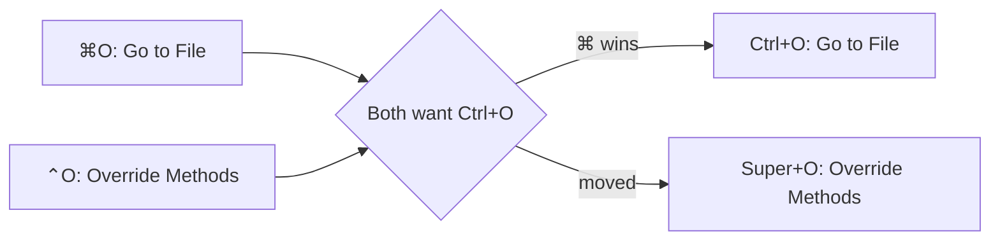

<div align="center">

# ⌨️ JetBrains macOS → Linux

**Your macOS keymap, working on Linux. No rebinding hundreds of shortcuts by hand.**

[](LICENSE)
[](https://nodejs.org)
[](https://www.typescriptlang.org)
[](https://www.jetbrains.com)

🍎 ⌘O &nbsp;→&nbsp; 🐧 Ctrl+O

</div>

---

## 🤔 Why this exists

Copying a macOS keymap to Linux looks like it should work, then fails in ways that are hard to spot:

| 💥 The problem | ✅ What the converter does |
|---|---|
| Your ⌘ shortcuts expect a Command key, which is Super on Linux | Turns ⌘ into Ctrl |
| A keymap file only lists your changes, and the macOS defaults it builds on don't load on Linux | Merges those defaults into the new keymap |
| ⌘O and ⌃O both become Ctrl+O | Gives ⌘ the slot, moves the other shortcut to Super, and tells you |
| `Force touch` makes Linux IDEs stop loading the keymap partway through | Removes it |

## 🚀 Quick start

```bash
git clone https://github.com/patrickclery/jetbrains-macos-to-linux.git
cd jetbrains-macos-to-linux
npm install

npx tsx src/cli.ts MyMacKeymap.xml -o MyLinuxKeymap.xml --name "My Linux Keymap"
```

## 🗺️ Full walkthrough

### 1. 📦 Find your macOS keymap

Pick whichever is easiest:

- **Settings Sync:** if it's on, your Mac keymap may already be on your Linux machine, in `~/.config/JetBrains/<product><version>/settingsSync/keymaps/`.
- **Export:** on your Mac, go to **File → Manage IDE Settings → Export Settings**, tick **Keymaps**, and unzip the result on Linux.
- **Copy the file:** on your Mac, look in `~/Library/Application Support/JetBrains/<product><version>/jba_config/mac.keymaps/`.

### 2. 🔍 Scan your IDE's plugin shortcuts (recommended)

Plugins declare some shortcuts outside the keymap files. Scanning your install lets the converter catch collisions with them:

```bash
python3 scripts/scan_plugin_shortcuts.py ~/.local/share/JetBrains/Toolbox/apps/rubymine
```

Add your user plugins folder as a second path to cover those too. The results stay on your machine and are ignored by git.

### 3. 🔄 Convert

```bash
npx tsx src/cli.ts MyMacKeymap.xml -o MyLinuxKeymap.xml --name "My Linux Keymap" 2> report.txt
```

`report.txt` lists every shortcut that moved or was dropped:

```text
OverrideMethods: moved to meta O (ctrl O is used by GotoFile)
PinActiveTab: moved to meta p (ctrl p is used by Vcs.Push)
```

### 4. 📥 Install

With the IDE **closed**, because it can overwrite changes made while it's running:

```bash
cp MyLinuxKeymap.xml ~/.config/JetBrains/<product><version>/keymaps/
```

### 5. 🎯 Select it

Open **Settings → Keymap** and choose your new keymap from the dropdown. Installing it doesn't select it. Done! 🎉

## 🔀 How shortcuts are converted

| macOS | Linux | Rule |
|---|---|---|
| ⌘O | Ctrl+O | ⌘ becomes Ctrl |
| ⌃1 | Ctrl+1 | Ctrl stays Ctrl |
| ⌃⌘⇧P | Ctrl+Alt+Shift+P | ⌘ becomes Alt when Ctrl is also held |
| ⌥⏎ | Alt+Enter | Alt and Shift stay the same |
| Force touch | *removed* | Mac trackpads only |

### 💥 When two shortcuts collide

macOS has more modifier combinations than this mapping can keep apart. The winner is chosen in this order:

1. 🥇 Plain ⌘ shortcuts, your own before inherited ones
2. 🥈 Your other shortcuts: ⌘⌥, then ⌃, then ⌘⌃
3. 🥉 Other inherited shortcuts, in the same order



The losing shortcut moves to its macOS spelling using Super, so ⌃R becomes Super+R and ⌘⌥M becomes Super+Alt+M. It's dropped if that slot is also taken.

> [!NOTE]
> Your desktop may grab some Super shortcuts before the IDE sees them. KDE uses Super+D, for example. Check your report for anything you rely on and rebind it in **Settings → Keymap**.

## ⚙️ Options

| Option | What it does |
|---|---|
| `-o <file>` | Write to a file instead of stdout |
| `--name <name>` | Set the name shown in the IDE's keymap dropdown |
| `--parent <name>` | Set the parent keymap, which defaults to `$default` |
| `--no-parent` | Remove the parent and write every default shortcut into the keymap |

## 🩺 Troubleshooting

**Most shortcuts do nothing.** Check that the dropdown shows the new keymap. Output from older versions of this tool has the `Force touch` bug, so convert again from your *original* macOS keymap. The IDE may have saved a partly loaded keymap over the old output, so don't reuse that file.

**⌘Q doesn't have a Linux equivalent.** macOS handles it, so it isn't in the keymap. Use Alt+F4 or **File → Exit**.

## 💡 Compatibility

Developed and tested with RubyMine 2026.2 on KDE Plasma (Wayland). The keymap format is shared across IntelliJ-based IDEs, so WebStorm, IntelliJ IDEA, PyCharm, GoLand and the rest should work too, but they haven't been tested. Reports are welcome!

## 🧪 Development

```bash
npm test
```

## 📄 License

[MIT](LICENSE) © 2026 Patrick Clery

The keymaps in [`keymaps/`](keymaps) come from [IntelliJ IDEA Community](https://github.com/JetBrains/intellij-community) under the [Apache License 2.0](keymaps/LICENSE). See the [notice](keymaps/NOTICE). This project isn't affiliated with or endorsed by JetBrains.
